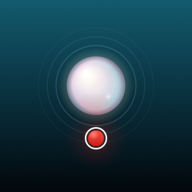
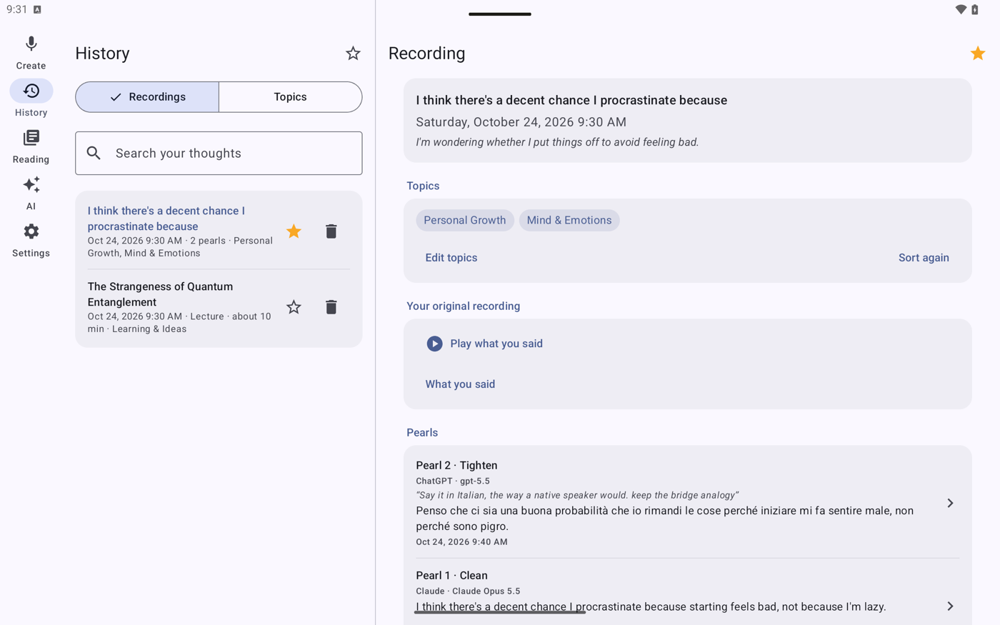
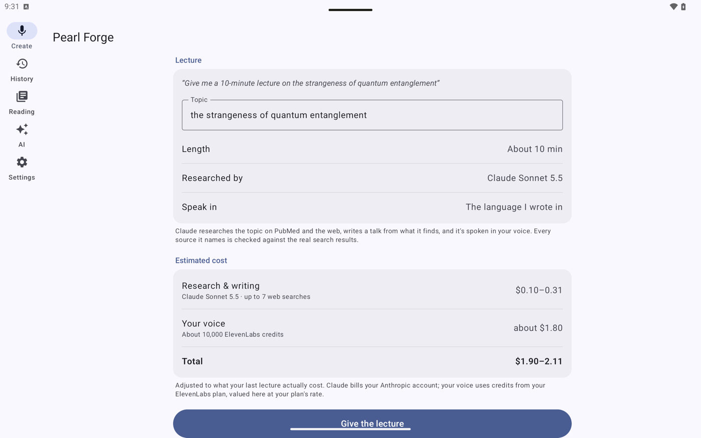
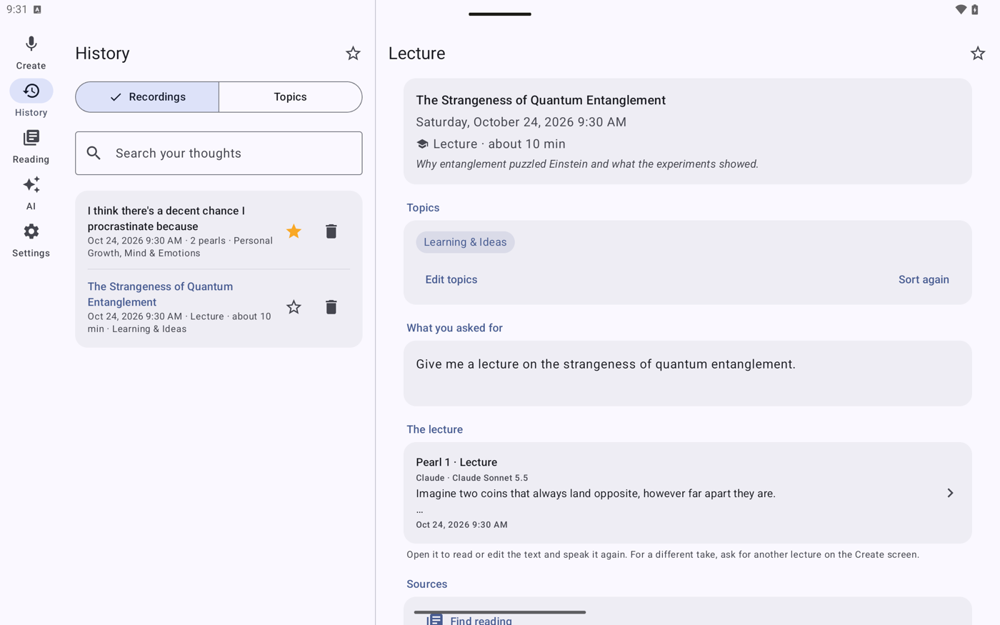

<p align="center">
  
</p>

<h1 align="center">Pearl Forge for Android</h1>

<p align="center">
  Record a rough thought. Pearl Forge tidies the wording <b>without changing what you meant</b>,<br>
  then reads it back to you <b>in your own cloned voice</b>. Built for tablets like the Galaxy Tab S9.
</p>

<p align="center">
  
</p>

<p align="center">
  
  
</p>

---

## What it does

This is the Android version of [Pearl Forge for iPhone](https://github.com/SolidPlisskin/pearl-forge-ios), with the same features:

- **Record or type**, then choose **Clean**, **Tighten** or **Summarize**. Your hedges stay hedges, nothing is added that you didn't say, and it still sounds like you.
- **Hear it in your voice**, through your own [ElevenLabs](https://elevenlabs.io) voice clone, in your language or one of 29 others.
- **Keep every version**: the untouched original recording, and every polished "pearl" you make from it.
- **Topics** that sort themselves, with **Play all in order** for everything you've said about one subject.
- **Find reading** on PubMed and the web, with every source checked against the real search results.
- **Lectures**: say *"Give a 10-minute lecture on…"*. Claude researches it, writes a talk, and it's spoken in your voice. The cost estimate comes first; the actual cost is shown afterwards.
- **Your choice of AI**: Claude by default, or ChatGPT, Gemini or OpenRouter.

It's designed for a tablet. The tabs sit down the left side, and History shows your recordings and the open one side by side. On narrower screens the tabs move to a bar along the bottom.

## Same app, same files

The prompts, lecture rules, cost estimates and recording format match the iPhone app exactly. Automated tests check this against files generated by the iPhone app's own code, so the two can't quietly drift apart. A recording folder made on one opens on the other.

## Privacy

- There are no accounts and no Pearl Forge servers. The app talks straight to the services you choose, with your own keys, and they bill you directly.
- Keys are encrypted with Android's Keystore and stay on the tablet. They're never in the code or in backups.
- Recordings are kept in the app's own folder on the tablet. You can copy them to a computer over USB. Uninstalling the app deletes them.

## Building it

You need JDK 21 and the Android SDK (platform 36). Android Studio includes both.

```bash
./gradlew testDebugUnitTest assembleDebug
```

Install `app/build/outputs/apk/debug/app-debug.apk` on a tablet with USB debugging turned on (`adb install`). Then add your ElevenLabs key in Settings and your Claude key in the AI tab.

Unlike a free iPhone install, an Android install doesn't expire.

## Inside the code

| Folder | What's there |
|---|---|
| `app/src/main/java/…/pipeline` | The cloud calls, prompts, research, lectures and cost estimates |
| `app/src/main/java/…/recordings` | How recordings and pearls are saved |
| `app/src/main/java/…/ui` | The screens (Jetpack Compose) |
| `app/src/main/java/…/settings` | Encrypted keys and the AI choices |
| `app/src/test` | Tests against the iPhone app's output, plus stand-in network tests |
| `Design` | The script that draws the launcher icon |

Written in Kotlin with Jetpack Compose and Material 3, using OkHttp and kotlinx.serialization.

---

A personal project, built with [Claude Code](https://claude.com/claude-code). It's shared here so people can see it, but there's no open-source license yet, so please ask before reusing the code.
